  <picture>
    <source media="(prefers-color-scheme: dark)" srcset="./dark.svg">
    <source media="(prefers-color-scheme: light)" srcset="./light.svg">
    
  </picture>

## 👋 About

I'm **Lucky**  an Android & web app developer from Bokaro, India. I design and build complete products end to end: idea → clean UI → working, shipped software.

- 🎓 BCA student (IGNOU), currently in my 3rd semester
- 💻 Learning the **MERN stack** alongside building real products
- 🎯 Working towards **GSoC 2027** on the web track
- 🤝 Open to **freelance projects and collaborations**  [code.rahulx@gmail.com](mailto:code.rahulx@gmail.com)

> *I build apps people actually use.*

---

## 🚀 Featured Projects

### [ARISE](https://luckyxdev.me/projects/arise) — Gamified Fitness App
Fitness that plays like a game. Your camera counts your reps with on-device pose detection, workouts earn XP and unlock quests, and a focus mode blocks distracting apps while you train.
`React Native` `Expo` `TypeScript` `Kotlin` `ML Kit` `Supabase`

### [Gym Management](https://luckyxdev.me/products/gym-management) - Member & Fee App for Gyms
Replaces the gym owner's notebook. Member records, automatic monthly fee dues, payment receipts, and one-tap WhatsApp payment reminders  fully offline first, built for a real 100+ member gym.
`React Native` `Expo` `TypeScript` · **[⬇ Download the free Android APK](https://luckyxdev.me/products/gym-management)**

---

## 🛠️ Engineering Stack

**Languages** - TypeScript · JavaScript · C++

**Frontend & Mobile** — React · Next.js · React Native · Expo

**Backend & Data** — Node.js · Express · MongoDB · Supabase · PostgreSQL

**Tools** — Git · GitHub · VS Code

---

## 🌱 Currently

- 📱 Polishing **Gym Management** for its first gym
- 🏋️ Building **ARISE** towards a public APK release
- 📚 Deep in DSA, DBMS and MERN coursework

---

## 🔗 Connect

- 🌐 Portfolio — [luckyxdev.me](https://luckyxdev.me)
- 💼 LinkedIn — [linkedin.com/in/rahul-mahato-46111234a](https://www.linkedin.com/in/rahul-mahato-46111234a/)
- ✉️ Email — [code.rahulx@gmail.com](mailto:code.rahulx@gmail.com)

<code>~/profile $ build --ship</code>

